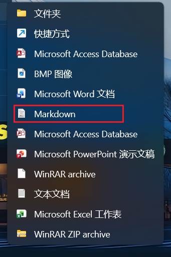

# 右键新建 Markdown 文件

 

在 Windows 资源管理器里右键 →「新建」，点一下 **Markdown**，当场生成一个空的 `.md` 文件。

系统自带的新建菜单里没有 Markdown 这一项；装了 MarkText 这类编辑器之后，就算有，名字也是一长串 `MarkText Markdown Document`。这个小工具一次把两件事办了：**加上这一项，并把名字固定成短短的 `Markdown`**。所有改动只写在当前用户层，不需要管理员权限，随时可以完整恢复。



## 快速开始

1. 下载最新版压缩包：[Releases 页面](https://github.com/xiaoyaodev/new-markdown/releases) 里的 `new-markdown.zip`，解压；
2. 双击 `ShortenMDName.bat`，黑窗跑完会自动重启一次资源管理器（桌面闪一下是正常现象）；
3. 回到桌面或任意文件夹，右键 → 新建，点 `Markdown` 就能新建文件。

不用装任何东西，`.bat` 和 `.ps1` 两个文件放一起、双击就完事。前提是你的 `.md` 已经关联了某个编辑器（MarkText、Typora、VS Code 都行）。

## 文件清单

| 文件 | 作用 |
|---|---|
| `ShortenMDName.ps1` | 干活的脚本：给 `.md` 加上新建项，并把菜单里显示的名字改成 `Markdown` |
| `ShortenMDName.bat` | 上面那个脚本的启动器，双击它来运行 |
| `ShortenMDName-undo.bat` | 恢复到运行脚本之前的样子 |
| `RestartExplorer.bat` | 重启资源管理器，让改动立刻在菜单里生效 |

脚本具体做了什么：给 `.md` 在当前用户层新建一个专属文件类型，显示名写成 `Markdown`，并登记「新建时生成空文件」；打开命令和图标从你原来的关联原样复制，所以双击 `.md` 用哪个软件打开完全不变。脚本对你编辑器自己的登记只读不改。运行前它会先把 `.md` 原来的设置备份成同文件夹下的 `md-backup.reg`，而且只备份第一次，重复运行不会覆盖——这个备份文件是恢复时用的，别删。

如果跑完菜单里还没变化，双击一次 `RestartExplorer.bat` 即可（等同于在任务管理器里对「Windows 资源管理器」点重新启动）。

为什么不能双击 `.ps1` 直接运行：Windows 默认双击 PowerShell 脚本只会用记事本打开，所以配了一个 `.bat` 当启动器，两个文件必须放一起。

## 怎么改

**改菜单里显示的名字**

用记事本打开 `ShortenMDName.ps1`，找到这一行：

```powershell
$displayName = 'Markdown'
```

把引号里换成想要的名字，比如 `'Markdown 文件'`、`'MD 笔记'`，存盘，再双击一次 `ShortenMDName.bat` 即可。

**给别的后缀也加一项**（比如 `.markdown`）

把 `ShortenMDName.ps1` 里的 `.md` 全部换成目标后缀、名字改好，另存一份，再配一个同名的 `.bat` 启动它（把现有 `.bat` 复制一份、改掉里面的脚本文件名就行）。原理一样：新建项负责「菜单里有这一项」，专属类型负责「这一项叫什么」。

**换双击打开的编辑器**

先在 Windows 里把 `.md` 的默认打开方式改成新编辑器（右键任意 `.md` → 打开方式 → 选择其他应用 → 勾选「始终」），再重新运行一次脚本，脚本会把新的打开命令复制进专属类型。

## 怎么恢复

双击 `ShortenMDName-undo.bat`。它会导入脚本当初备份的 `md-backup.reg`、删掉专属类型、重启资源管理器，菜单和关联都回到运行脚本之前的状态，新建里的这一项也随之消失。

没有这个 `.bat` 也行：手动双击导入 `md-backup.reg`，再运行一次 `RestartExplorer.bat`，效果一样（专属类型留着没人指向，也不会起作用）。

注意：备份 `md-backup.reg` 是在你自己电脑上第一次运行脚本时生成的，只存在于你放脚本的那个文件夹里，压缩包里没有。所以恢复的前提是这个文件还在。

## 原理

- 新建菜单的条目来自注册表 `HKEY_CURRENT_USER\Software\Classes\.md\ShellNew`，里面放一个空字符串值 `NullFile`，意思是「新建时生成一个空文件」。
- 条目显示的名字取自 `.md` 所指文件类型（ProgID）的描述文字。编辑器安装时写的描述往往很长，所以脚本另建了一个专属类型，只改描述，不动打开命令。
- 全部写在 `HKEY_CURRENT_USER` 下，只影响当前用户，不用管理员权限，也不会动系统层和其他用户的设置。

## 适用范围

Windows 10 / 11。和具体编辑器无关，MarkText、Typora、VS Code 都行，前提是 `.md` 已经关联到某个编辑器（没关联的话新建出来的文件双击打不开，先随便找个编辑器关联一次）。

## English Summary

Adds a clean **Markdown** entry to the Windows Explorer "New" context menu. Run `ShortenMDName.bat` once: it creates a dedicated file type for `.md` named `Markdown`, registers the ShellNew entry, and restarts Explorer. Your editor's own registration and open command are left untouched, everything lives under `HKEY_CURRENT_USER` (no admin rights needed), and `ShortenMDName-undo.bat` restores the previous state from the automatic backup.

## License

MIT
